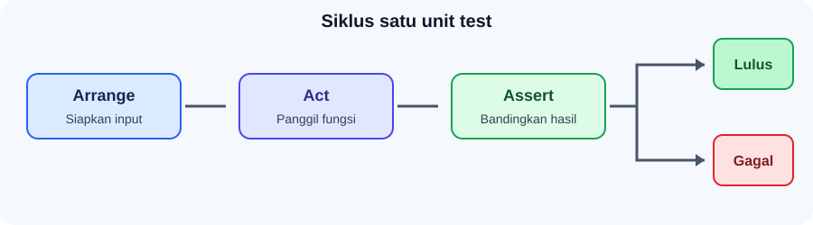
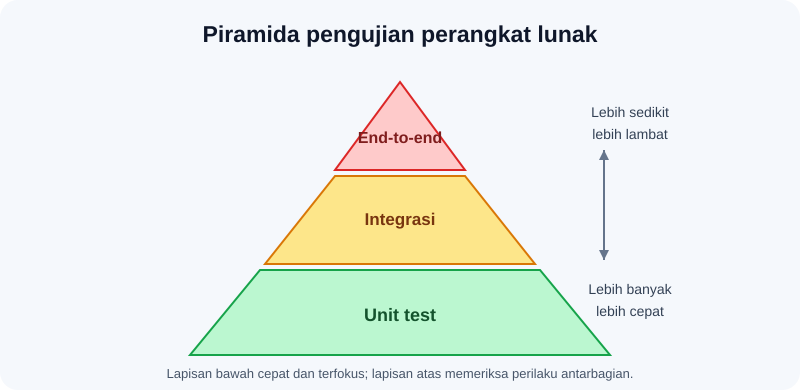

# Pengujian Unit - Latihan Soal

**Materi praktik JavaScript dengan `node:test`**

## Tujuan belajar

Setelah menyelesaikan materi ini, peserta diharapkan mampu:

- Menjelaskan tujuan dan batas unit testing.
- Menulis test dengan pola Arrange, Act, Assert (AAA).
- Memeriksa hasil normal, batas, dan input tidak valid.
- Menjalankan test otomatis menggunakan Node.js.
- Menggunakan hasil test untuk menemukan regresi.

## 1. Apa itu pengujian unit?

Pengujian unit adalah pemeriksaan otomatis untuk bagian kecil program, misalnya satu fungsi, secara terpisah dari komponen lain. Test yang baik memiliki masukan yang jelas, hasil yang diharapkan, dan dapat dijalankan berulang kali.

Unit test membantu mendeteksi kesalahan lebih awal. Unit test tidak membuktikan bahwa seluruh aplikasi bebas bug; integrasi antarkomponen dan perilaku aplikasi secara keseluruhan tetap memerlukan pengujian lain.

### Pola AAA

1. **Arrange** - siapkan data dan kondisi awal.
2. **Act** - jalankan fungsi yang diuji.
3. **Assert** - bandingkan hasil aktual dengan hasil yang diharapkan.



## 2. Struktur latihan

Skenario latihan adalah fungsi total pembayaran pesanan. Aturan bisnisnya:

- Subtotal dan ongkos kirim harus berupa angka terbatas dan tidak negatif.
- Persentase diskon harus berupa angka antara 0 sampai 100.
- Diskon dihitung dari subtotal; ongkos kirim ditambahkan setelah diskon.
- Hasil akhir dibulatkan menjadi dua angka desimal.
- Input yang tidak valid harus menghasilkan error yang jelas.

Struktur folder:

```text
src/
  checkout.js
tests/
  checkout.test.js
```

## 3. Contoh implementasi

File `src/checkout.js`:

```javascript
function assertNonNegativeAmount(value, name) {
  if (typeof value !== 'number' || !Number.isFinite(value)) {
    throw new TypeError(`${name} harus berupa angka terbatas.`);
  }
  if (value < 0) {
    throw new RangeError(`${name} tidak boleh negatif.`);
  }
}

function calculateOrderTotal(subtotal, discountPercent, shippingFee) {
  assertNonNegativeAmount(subtotal, 'Subtotal');
  assertNonNegativeAmount(shippingFee, 'Ongkos kirim');

  if (typeof discountPercent !== 'number' || !Number.isFinite(discountPercent)) {
    throw new TypeError('Persentase diskon harus berupa angka terbatas.');
  }
  if (discountPercent < 0 || discountPercent > 100) {
    throw new RangeError('Persentase diskon harus berada di antara 0 dan 100.');
  }

  const discount = subtotal * (discountPercent / 100);
  const total = subtotal - discount + shippingFee;
  return Math.round((total + Number.EPSILON) * 100) / 100;
}

module.exports = { calculateOrderTotal };
```

## 4. Contoh unit test

File `tests/checkout.test.js`:

```javascript
const test = require('node:test');
const assert = require('node:assert/strict');
const { calculateOrderTotal } = require('../src/checkout');

test('menghitung subtotal dengan ongkos kirim tanpa diskon', () => {
  assert.equal(calculateOrderTotal(100000, 0, 10000), 110000);
});

test('mengurangi diskon dari subtotal sebelum menambah ongkir', () => {
  assert.equal(calculateOrderTotal(250000, 10, 15000), 240000);
});

test('diskon 100 persen menyisakan ongkos kirim', () => {
  assert.equal(calculateOrderTotal(50000, 100, 8000), 8000);
});

test('membulatkan hasil ke dua angka desimal', () => {
  assert.equal(calculateOrderTotal(120.5, 10, 5), 113.45);
});

test('menerima nilai nol', () => {
  assert.equal(calculateOrderTotal(0, 0, 0), 0);
});

test('menolak subtotal negatif', () => {
  assert.throws(() => calculateOrderTotal(-1, 0, 0), RangeError);
});

test('menolak ongkos kirim negatif', () => {
  assert.throws(() => calculateOrderTotal(100, 0, -1), RangeError);
});

test('menolak diskon di luar rentang 0 sampai 100', () => {
  assert.throws(() => calculateOrderTotal(100, 101, 0), RangeError);
});

test('menolak teks sebagai subtotal', () => {
  assert.throws(() => calculateOrderTotal('100', 0, 0), TypeError);
});

test('menolak angka bukan terbatas', () => {
  assert.throws(() => calculateOrderTotal(Infinity, 0, 0), TypeError);
});
```

Diagram berikut menunjukkan bahwa unit test merupakan lapisan pengujian yang cepat dan terfokus; pengujian integrasi dan end-to-end melengkapi, bukan digantikan olehnya.



## 5. Cara menjalankan

Dari terminal di folder paket ini jalankan:

```powershell
node --test
```

Node.js akan menampilkan jumlah test yang lulus dan gagal. Jika test gagal, baca nama test dan perbedaan nilai aktual dengan nilai yang diharapkan sebelum mengubah implementasi.

## 6. Latihan mandiri

1. **Test tanpa diskon** - tulis test untuk subtotal 75.000 dan ongkos kirim 12.000.
2. **Batas diskon** - pastikan diskon 0% dan 100% menghasilkan total yang tepat.
3. **Pembulatan** - tambahkan test untuk nilai pecahan yang hasil akhirnya memiliki lebih dari dua angka desimal.
4. **Validasi input** - tambahkan test untuk `NaN`, ongkos kirim berupa teks, dan diskon negatif.
5. **Perilaku baru** - buat fungsi `calculateDiscount(subtotal, discountPercent)` terpisah, kemudian uji kasus normal, nilai batas, serta input tidak valid.
6. **Regresi** - ubah sementara perhitungan agar ongkos kirim ikut didiskon. Jalankan test dan amati test mana yang menangkap perubahan aturan bisnis. Pulihkan implementasi setelah percobaan.

### Kriteria penilaian

- Test mencakup alur normal dan nilai batas.
- Test memeriksa input tidak valid, bukan hanya hasil sukses.
- Nama test menjelaskan perilaku yang diharapkan.
- Setiap test dapat dijalankan secara mandiri dan hasilnya konsisten.
- Test tidak bergantung pada urutan eksekusi atau layanan eksternal.

## 7. Ringkasan

Unit test yang bermanfaat fokus pada perilaku fungsi, menguji kasus normal dan batas, serta memberikan pesan kegagalan yang mudah dipahami. Mulailah dari aturan bisnis, tulis contoh input-output, kemudian otomasi contoh tersebut dengan assertion.
